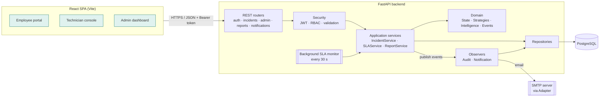
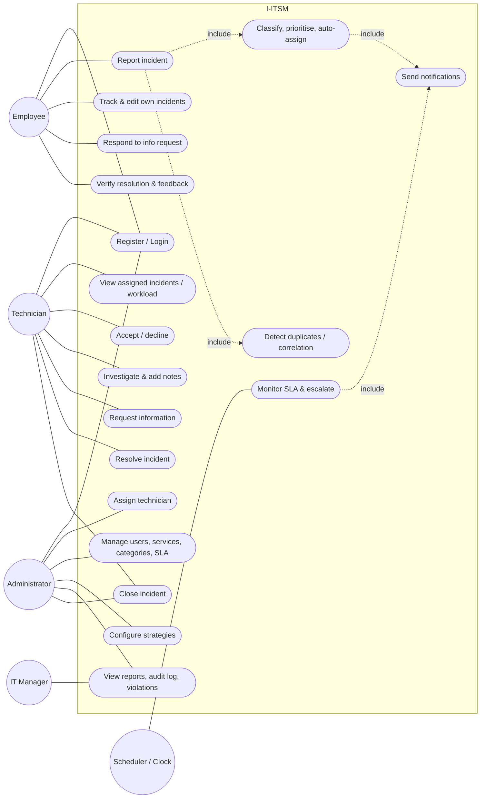
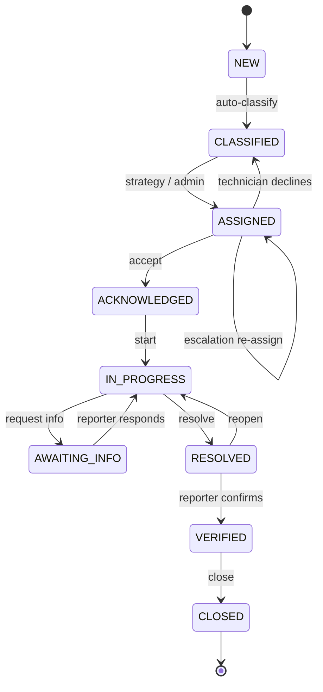
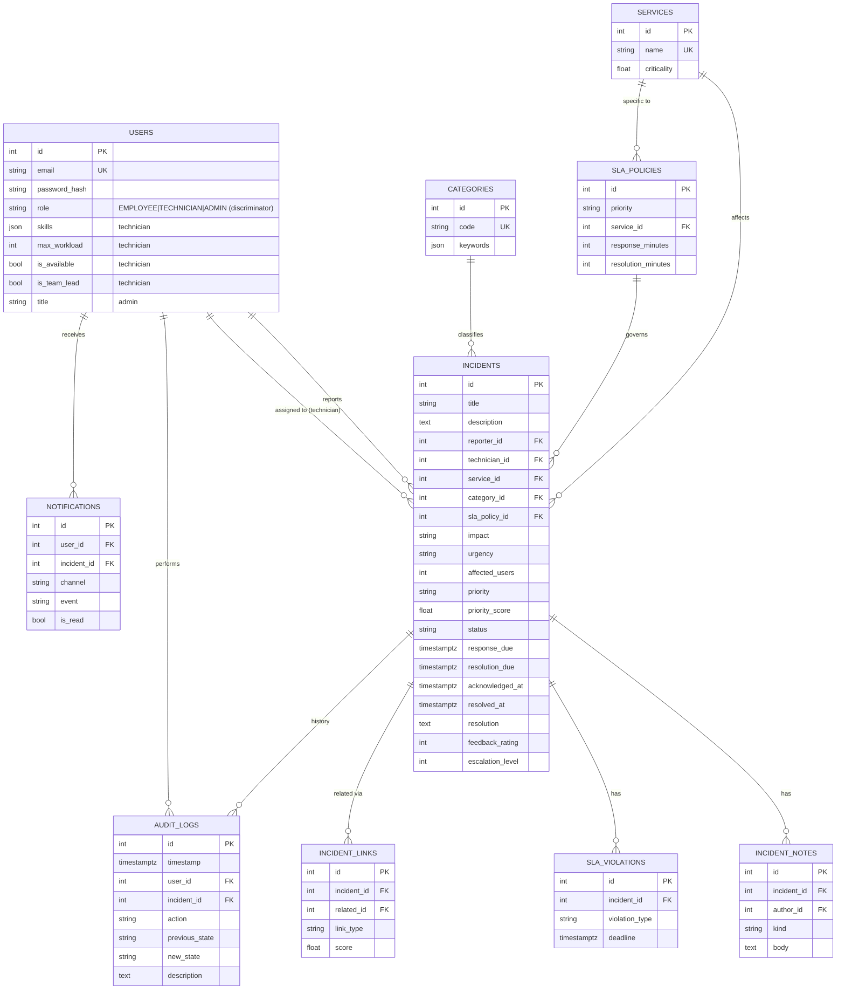

# I-ITSM — Project Report

**Intelligent IT Service Management & Incident Resolution System**
CS F213 / MAC F212 · Object-Oriented Programming · Semester I 2026-27

> Diagrams are written in Mermaid. They render on GitHub, in VS Code (Mermaid extension)
> and at https://mermaid.live — paste a block there to export PNG/SVG for the PDF report.

---

## 1. Problem analysis

**Problem.** An organisation depends on many IT services (payments, databases, SSO, email,
network…). When one fails, reports arrive by phone/email, are prioritised by gut feeling,
assigned ad-hoc, and frequently miss their SLAs. Duplicate reports waste effort and no one
can reconstruct what happened afterwards.

**Stakeholders.** Employees (reporters) · Technicians / support engineers · Team leads ·
System administrators · IT manager · Business owners of each service.

**Existing challenges.** Delayed response · wrong prioritisation · unbalanced technician
load · SLA violations noticed too late · duplicate tickets · incomplete history · no view of
recurring problems.

**Proposed solution.** A web application that manages the full lifecycle
*Report → Classify → Prioritise → Assign → Investigate → Resolve → Verify → Close*,
with automatic priority scoring, pluggable assignment strategies, background SLA monitoring
with escalation, duplicate/correlation detection, multi-channel notifications, dashboards
and an immutable audit trail.

**Assumptions.**
* One organisation (single tenant); every employee can self-register, privileged accounts are created by an administrator.
* SLA clocks run 24×7 from creation (no business-hours calendar, no pause while awaiting info).
* An incident has exactly one assigned technician at a time.
* "Business criticality" is a property of the IT service (1x–3x), configured by the admin.
* Email can be simulated; in-app notifications are delivered by polling (15 s).

---

## 2. Requirements specification

### 2.1 Functional requirements
| ID | Requirement | Where |
|---|---|---|
| FR-1 | Employees register, log in, report incidents, view/track/edit their incidents | `api/auth.py`, `api/incidents.py` |
| FR-2 | Employees answer information requests, verify resolution, give 1–5★ feedback, reopen | `IncidentService.respond_info/verify/reopen` |
| FR-3 | Technicians view assigned incidents, accept/decline, investigate (notes), request info, resolve, view workload, toggle availability | `IncidentService`, `/me/workload` |
| FR-4 | Admins manage users, technicians (skills, capacity), IT services, categories, SLA policies, strategies; monitor incidents, reports, audit log, SLA violations | `api/admin.py`, `api/misc.py` |
| FR-5 | Incidents are auto-classified (or user-chosen) | `CategoryClassifier` |
| FR-6 | Priority computed as Impact × Urgency × Criticality → P1–P4 | `domain/priority.py` |
| FR-7 | Applicable SLA identified (service-specific overrides default); response & resolution deadlines calculated | `SLAService.apply` |
| FR-8 | Technician auto-assigned using a configurable strategy (≥ 2 implemented: Load, Round-Robin, Skill-based) | `domain/assignment.py` |
| FR-9 | Lifecycle enforced; illegal transitions rejected | `domain/lifecycle.py` |
| FR-10 | Notifications on create/assign/priority change/info request/resolve/close/SLA warning/violation/escalation, via in-app + email | `services/notifications.py` |
| FR-11 | SLA monitored continuously: warnings at 75 %, violations recorded, automatic escalation | `SLAMonitor` (background task) |
| FR-12 | Every important action audited (timestamp, user, action, incident, previous/new state, description) | `AuditObserver` |
| FR-13 | Search/filter by ID, text, status, priority, category, service, technician, reporter, date range, SLA state (10 criteria) | `IncidentRepository.search` |
| FR-14 | Dashboards: overview, technician workload, service analysis, trend, correlation clusters | `ReportService` |
| FR-15 | Intelligent features: duplicate detection, incident correlation, automatic escalation, smart technician recommendation, auto-categorisation, suggested resolutions, SLA-risk detection | `domain/intelligence.py`, `sla.py` |

### 2.2 Non-functional requirements
* **Security** — bcrypt password hashing, JWT bearer auth, role- and permission-based authorisation, server-side validation (Pydantic), no user enumeration on login.
* **Maintainability / extensibility** — new category = admin config; new assignment/priority algorithm = one subclass; new notification channel = one class + factory registration; new reaction to events = one observer.
* **Reliability** — every business error is a typed exception mapped to an HTTP status; a failing observer (e.g. SMTP down) never breaks the transaction.
* **Performance** — indexed columns for status, priority, service, technician, created_at; monitor runs in O(active incidents).
* **Portability** — PostgreSQL in production, SQLite for tests; Docker Compose for one-command start.
* **Usability** — a separate portal per role, each with its own shade of brown and its own navigation; live assistant while reporting.

### 2.3 User roles
| Role | Capabilities |
|---|---|
| Employee | create / view own / edit own / respond / verify / feedback / reopen / comment |
| Technician | view assigned & browse all / accept / decline / investigate / request info / resolve / close after verification / workload |
| Administrator (System Admin, IT Manager) | everything + assign, force status, configure, reports, audit |

### 2.4 Business rules
1. `score = impact × urgency × criticality` with LOW = 1, MEDIUM = 1.5, HIGH = 2, criticality ∈ [1, 3]. P1 ≥ 6, P2 ≥ 3.5, P3 ≥ 2, else P4.
2. Default SLA (minutes, response/resolution): P1 5/30, P2 15/120, P3 60/480, P4 240/1440. Service-specific policies override (e.g. Payment Gateway P1: 3/20).
3. A technician can only be assigned if active, available, not previously declined this incident and below `max_workload`.
4. Technicians with a matching skill are preferred; otherwise any available technician.
5. The same reporter cannot submit a near-identical active incident within 24 h (≥ 0.9 similarity) unless they explicitly override.
6. Similarity ≥ 0.55 → *duplicate* link; ≥ 0.35 → *correlated*; ≥ 3 incidents on the same service within 2 h → correlation cluster (possible major incident).
7. P1/P2 incidents not acknowledged by the response deadline escalate one level per elapsed response window: Team Lead (re-assigned) → System Admin → IT Manager.
8. Only the reporter (or an admin) verifies a resolution; a technician may close only after verification.
9. Resolved/closed incidents cannot be edited by employees; changing impact/urgency/service recalculates priority and SLA.

---

## 3. System architecture

**Layering.** Routers only translate HTTP ↔ Python. Services orchestrate. The `domain`
package has no dependency on FastAPI or SQL — it can be unit-tested in isolation.
Repositories are the only place that writes queries.

---

## 4. UML

### 4.1 Use-case diagram

### 4.2 Class diagram (domain core)

```mermaid
classDiagram
  direction TB
  class User {
    <<abstract>>
    -int id
    -str email
    -str _password_hash
    +set_password(raw)
    +verify_password(raw) bool
    +permissions() set
    +can(permission) bool
    +dashboard() str
  }
  class Employee { +permissions() +dashboard() }
  class Technician {
    +list skills
    +int max_workload
    +bool is_available
    +bool is_team_lead
    +workload int
    +has_capacity() bool
    +has_skill(code) bool
    +resolved_count(code) int
  }
  class Administrator { +str title }
  User <|-- Employee
  User <|-- Technician
  User <|-- Administrator

  class Incident {
    +str title
    +str impact
    +str urgency
    +str priority
    +float priority_score
    +str status
    +datetime response_due
    +datetime resolution_due
    +state IncidentState
    +transition_to(target)
  }
  class IncidentNote
  class ITService { +float criticality }
  class Category { +str code +list keywords }
  class SLAPolicy { +str priority +int response_minutes +int resolution_minutes }
  class AuditLog
  class SLAViolation
  Incident "1" *-- "*" IncidentNote : composition
  Incident "1" *-- "*" SLAViolation : composition
  Incident "*" --> "1" Employee : reporter
  Incident "*" o-- "0..1" Technician : assigned
  Incident "*" --> "1" ITService : affects
  Incident "*" --> "0..1" Category
  Incident "*" --> "0..1" SLAPolicy
  SLAPolicy "*" --> "0..1" ITService

  class IncidentState {
    <<abstract>>
    +allowed set
    +transition(ctx, target)
    +on_enter(ctx, prev)
  }
  IncidentState <|-- NewState
  IncidentState <|-- ClassifiedState
  IncidentState <|-- AssignedState
  IncidentState <|-- AcknowledgedState
  IncidentState <|-- InProgressState
  IncidentState <|-- AwaitingInfoState
  IncidentState <|-- ResolvedState
  IncidentState <|-- VerifiedState
  IncidentState <|-- ClosedState
  Incident ..> IncidentState : delegates

  class PriorityStrategy { <<interface>> +score(input) +classify(score) +calculate(input) }
  PriorityStrategy <|.. WeightedScoreStrategy
  WeightedScoreStrategy <|-- UserImpactWeightedStrategy

  class AssignmentStrategy { <<interface>> +eligible() +select(incident, techs) #_choose() }
  AssignmentStrategy <|.. LoadBasedStrategy
  AssignmentStrategy <|.. RoundRobinStrategy
  AssignmentStrategy <|.. SkillBasedStrategy

  class EventBus { -list observers +subscribe(o) +publish(event) }
  class IncidentObserver { <<interface>> +notify(event) }
  IncidentObserver <|.. AuditObserver
  IncidentObserver <|.. NotificationObserver
  EventBus o-- IncidentObserver

  class NotificationChannel { <<interface>> +deliver(user, event, subject, msg) }
  NotificationChannel <|.. InAppChannel
  NotificationChannel <|.. EmailChannel
  class EmailGateway { <<interface>> +send(to, subject, body) }
  EmailGateway <|.. SmtpEmailAdapter
  EmailGateway <|.. SimulatedEmailAdapter
  EmailChannel o-- EmailGateway
  NotificationObserver o-- NotificationChannel

  class EscalationHandler { <<abstract>> +handle(inc) #escalate(inc) -next }
  EscalationHandler <|-- TeamLeadHandler
  EscalationHandler <|-- SystemAdminHandler
  EscalationHandler <|-- ITManagerHandler

  class IncidentService {
    +create() +assign() +accept() +decline() +start_work()
    +request_info() +respond_info() +resolve() +verify() +reopen() +close()
  }
  IncidentService *-- EventBus
  IncidentService *-- SLAService
  IncidentService *-- DuplicateDetector
  IncidentService *-- CategoryClassifier
  IncidentService ..> PriorityStrategy
  IncidentService ..> AssignmentStrategy
  IncidentService *-- IncidentRepository
  class Repository~T~ { +get(id) +find(id) +list() +add(obj) +delete(obj) }
  Repository <|-- IncidentRepository
  Repository <|-- UserRepository
  Repository <|-- SLAPolicyRepository
```

### 4.3 Incident lifecycle (state diagram)

---

## 5. OOP concepts — where to find them

| Concept | Implementation |
|---|---|
| **Encapsulation** | `User._password_hash` only reachable via `set_password/verify_password`; `Incident.status` changed only via `transition_to()`; repositories hide SQL. |
| **Abstraction** | `IncidentState`, `PriorityStrategy`, `AssignmentStrategy`, `NotificationChannel`, `EmailGateway`, `EscalationHandler`, `Repository[T]` are abstract base classes describing *what* not *how*. |
| **Inheritance** (true is-a) | `Employee/Technician/Administrator ⟶ User` (single-table inheritance); 9 concrete states ⟶ `IncidentState`; `UserImpactWeightedStrategy ⟶ WeightedScoreStrategy`; 17 exceptions ⟶ `ITSMError`. |
| **Polymorphism** | `user.permissions()` / `user.dashboard()` differ per subclass; `strategy.select()`; `channel.deliver()`; `state.on_enter()`; `handler.escalate()`. |
| **Interfaces** | ABCs + `typing.Protocol` (`LifecycleContext`, `KeyValueStore`). |
| **Composition** | `Incident` owns `IncidentNote` and `SLAViolation` (cascade delete-orphan); `IncidentService` is composed of repositories, detector, classifier, SLA service and event bus. |
| **Association / Aggregation** | Incident → Service, Category, SLAPolicy, Reporter (association); Incident ◇ Technician and EventBus ◇ Observers (aggregation – parts live independently). |
| **Exceptions** | `domain/exceptions.py` – `ITSMError` hierarchy with HTTP status + code, one global handler. |
| **Collections** | `dict` registries (strategies, states, channels), `set` for permissions & state transitions (O(1) membership), `Counter` for text vectors / report aggregation, `defaultdict(set)` graph + DFS stack for correlation clusters, `list` ordered observers. |

## 6. Design patterns (7 used)
| Pattern | Where | Why |
|---|---|---|
| **State** | `domain/lifecycle.py` | Transition rules + entry side-effects per lifecycle stage; NEW→CLOSED impossible by construction. |
| **Strategy** | `priority.py`, `assignment.py` | Admin swaps algorithms at runtime (*Admin → Strategies*); new algorithm = new class. |
| **Observer** | `events.py`, `notifications.py` | Audit and notifications react to events without coupling to incident logic. |
| **Factory** | `factories.py`, `NotificationChannelFactory`, `assignment_strategy()` | Centralised, validated creation of users/incidents/channels. |
| **Repository** | `repositories/` | Persistence abstraction; services never write SQL. |
| **Adapter** | `SmtpEmailAdapter` | Adapts `smtplib` to our `EmailGateway` interface; `SimulatedEmailAdapter` for dev. |
| **Chain of Responsibility** | `sla.py` escalation | Technician → Team Lead → System Admin → IT Manager, each handler decides or passes on. |
| (Template Method) | `PriorityStrategy.calculate`, `AssignmentStrategy.select` | Fixed algorithm skeleton, variable step. |

---

## 7. Technology stack & justification

| Layer | Choice | Libraries |
|---|---|---|
| Frontend | React 18 + Vite | react-router-dom |
| Backend | Python 3.12 + FastAPI | SQLAlchemy 2, Pydantic 2, PyJWT, bcrypt, uvicorn |
| Database | PostgreSQL 16 (SQLite for tests) | psycopg 3 |
| DevOps | Docker Compose, pytest | nginx (frontend container) |

1. **Language — Python.** First-class classes, ABCs, multiple inheritance, Protocols and dataclasses let us express every OOP concept clearly with little boilerplate; the team already knows it, so effort goes into design rather than syntax.
2. **Frontend — React.** Component model maps naturally to role-specific screens; huge ecosystem; Vite gives instant dev builds.
3. **Backend — FastAPI.** Type-hint-driven validation (Pydantic), automatic OpenAPI docs at `/docs`, dependency injection used for auth/RBAC, async support for the background SLA monitor.
4. **Database — PostgreSQL.** Relational data with strong integrity (FKs, unique constraints for SLA policies), JSON columns for skills/keywords, mature and free.
5. **Architecture — layered monolith + REST.** Simple to deploy and demo, while internal layering (router → service → domain → repository) keeps it ready to split into services.
6. **Alternatives considered.** Spring Boot (more verbose, slower iteration), Django (heavier, ORM-centric admin we don't need), Node/Express (weaker typing for domain modelling), MongoDB (our data is relational).
7. **Advantages / limitations.** + fast development, auto API docs, portable DB layer, strong validation. − Python is slower than JVM for CPU-heavy work; in-process background task is single-instance; polling instead of websockets for notifications.
8. **OOP support.** SQLAlchemy maps the class hierarchy directly (polymorphic `User`), so inheritance exists in both code and database; ABCs enforce interfaces at instantiation.
9. **Scaling.** Run several stateless API replicas behind a load balancer (JWT = no server sessions); move the SLA monitor to a dedicated worker (Celery/RQ + Redis) or a cron job with row locking; add read replicas & table partitioning by `created_at`; push notifications over WebSockets/Redis pub-sub; replace keyword similarity with vector embeddings (pgvector).

---

## 8. Database design

Additional tables: `email_outbox` (every email, simulated or sent), `system_config` (key/value: active strategies, round-robin pointer).
Constraint highlights: `UNIQUE(priority, service_id)` on SLA policies, `UNIQUE(incident_id, related_id)` on links, indexes on `incidents(status, priority, service_id, technician_id, created_at)`.
**Sample data:** `python -m app.seed` creates 8 services, 10 categories, 5 SLA policies, 10 users and 7 incidents (3 historical closed with resolutions, 4 live).

---

## 9. Security
* **Authentication:** email + password → JWT (HS256, 8 h expiry) sent as `Authorization: Bearer`.
* **Password protection:** bcrypt with per-password salt; policy ≥ 8 chars with letters and digits; hash never serialised.
* **Role-based authorisation:** `require_roles(Role.ADMIN)` dependencies on admin routes; fine-grained `user.can("incident:assign")` checks inside services; employees' queries are always scoped to their own incidents.
* **Input validation:** Pydantic schemas with lengths, ranges, enums, `extra="forbid"`; domain-level validation in factories.
* **Protection against unauthorised operations:** only the assigned technician may work an incident, only the reporter may verify, self-registration can only create employees, an admin cannot deactivate themselves.
* **Other:** generic login error (no account enumeration), CORS allow-list, parameterised queries via ORM (no SQL injection), audit of logins and configuration changes.

## 10. Exception handling
| Situation | Exception | HTTP |
|---|---|---|
| Invalid login | `InvalidLoginError` | 401 |
| Missing/expired token | `AuthenticationRequiredError` | 401 |
| Unauthorised operation | `UnauthorizedOperationError` | 403 |
| Invalid incident | `InvalidIncidentError` | 422 |
| Invalid state transition | `InvalidStateTransitionError` | 409 |
| Technician unavailable | `TechnicianUnavailableError` | 409 |
| Workload exceeded | `TechnicianWorkloadExceededError` | 409 |
| Service not found | `ServiceNotFoundError` | 404 |
| Missing SLA configuration | `MissingSLAConfigurationError` | 500 |
| Duplicate incident | `DuplicateIncidentError` | 409 |
| Database failure | `DatabaseFailureError` / `OperationalError` handler | 503 |
| Network failure (SMTP) | `NetworkFailureError` — caught, recorded in outbox, transaction continues | 502 |
| Invalid user input | `InvalidUserInputError` + Pydantic handler | 422 |

All responses share `{ "error": CODE, "message": "...", "details": {...} }`; the frontend shows them in a consistent error box (and a network-failure message when the server is unreachable).

---

## 11. Testing
`backend/tests` — **36 automated tests** (pytest; unit + API integration), all passing on SQLite and PostgreSQL.

| # | Test case | Type | Input / action | Expected |
|---|---|---|---|---|
| 1 | Priority thresholds | Boundary | scores 12, 6.0, 5.99, 3.5, 3.49, 2.0, 1.99, 1 | P1,P1,P2,P2,P3,P3,P4,P4 |
| 2 | Priority formula & polymorphic strategies | Normal | HIGH×HIGH×3, 100 users | 12 → P1; user-weighted 24 |
| 3 | Illegal transition NEW→CLOSED | Business rule / exception | `transition_to(CLOSED)` | `InvalidStateTransitionError` |
| 4 | State hooks | Normal | IN_PROGRESS→RESOLVED→IN_PROGRESS | resolved_at set then cleared |
| 5 | Load-based & round-robin | Normal | select repeatedly | least-loaded; rotation wraps |
| 6 | Workload exceeded | Exception | all techs at max | `TechnicianWorkloadExceededError` |
| 7 | Category suggestion | Normal | "cannot login, password locked" | AUTHENTICATION |
| 8 | Duplicate detection | Normal | "Unable to make payment" vs existing | matches payment, not printer |
| 9 | Missing SLA configuration | Exception | no policies | `MissingSLAConfigurationError` |
| 10 | SLA monitor violation + escalation | Business rule | time past response deadline | violation stored, breached flag, reassigned to team lead, audit |
| 11 | User polymorphism & password | Normal | permissions/dashboard per role | differ per subclass; bcrypt verify |
| 12 | New category without code change | Extensibility | add PRINTING category | classifier suggests it |
| 13 | Login + /me | Normal | valid credentials | 200, role ADMIN |
| 14 | Invalid login | Invalid input | wrong password | 401 INVALID_LOGIN |
| 15 | Registration validation | Invalid/boundary | short pwd, no digit, duplicate email (case-insensitive) | 422, 422, 201, 409 |
| 16 | Unauthenticated / forbidden | Authorisation | no token, bad token, employee→admin API | 401, 401, 403 |
| 17 | Employee isolation | Authorisation | employee B opens A's incident | 403; not in B's search |
| 18 | Create incident pipeline | Business rule | payment HIGH/HIGH | P1, score 12, APPLICATION, ASSIGNED, Gold SLA, audit entries |
| 19 | Invalid incident input | Invalid input | short title, bad enum, 0 users, unknown service | 422, 422, 422, 404 |
| 20 | Duplicate by same reporter | Exception | resubmit same text | 409 DUPLICATE_INCIDENT; `force` → 201 |
| 21 | Cross-reporter duplicate linking | Intelligent | similar text by another user | linked to INC1004; cluster reported |
| 22 | Full lifecycle | Workflow | resolve-before-accept, accept, start, note, request info, respond, resolve, rating 6, verify, close | 409 first; states progress; 422 for rating 6; CLOSED with audit |
| 23 | Only assignee works | Authorisation | other technician accepts; employee assigns | 403, 403 |
| 24 | Decline → reassign | Business rule | assignee declines | ASSIGNED to someone else |
| 25 | Manual assign / capacity | Exception | assign to full technician | 409 WORKLOAD_EXCEEDED; valid assign 200 |
| 26 | Search filters | Normal | priority+service+status, text, sla_status, id | correct subsets |
| 27 | Reports & notifications | Normal | overview, workload, bell, outbox | counts > 0, assignment notification & email |
| 28 | Admin configuration | Normal/invalid | switch to ROUND_ROBIN, unknown strategy, bad SLA, new category | 200, 422, 422, 201, audit logged |
| 29 | Suggest endpoint | Intelligent | "VPN disconnecting" | NETWORK + past VPN fix |

Run: `cd backend && pytest`.

---

## 12. Intelligent features implemented
1. **Automatic categorisation** — keyword/synonym classifier with confidence; admin-editable keywords.
2. **Duplicate detection** — cosine similarity over normalised tokens (stop-words, stemming, synonym canon e.g. *down/unavailable/unable/failing → outage*), + same-service bonus.
3. **Incident correlation** — burst detection per service (≥ 3 in 2 h) + connected-component clustering shown on the admin dashboard.
4. **Automatic escalation** — chain of responsibility driven by the SLA monitor.
5. **Smart technician recommendation** — skill match + category experience + seniority − workload (+ team lead bonus for P1); shown with scores on the assign panel.
6. **SLA risk detection** — AT_RISK at 75 % of the window; warnings sent once.
7. **Suggested resolutions** — similar historical incidents' fixes shown to reporters (while typing) and technicians.

## 13. Innovation items
Real-time operational dashboard (trend, workload utilisation, service analysis, clusters), automated escalation, incident similarity detection, analytics, Docker deployment, live "assistant" during reporting, real SMTP integration via adapter.

## 13a. User interface
One warm cream-and-brown palette; each role has its own shade so users always know which portal they are in. Strong reds and greens appear only where they carry meaning (P1, SLA breaches).

| Role | Portal | Shade | Main screens |
|---|---|---|---|
| Employee | Employee portal | Warm brown | My incidents, Report an incident (live assistant), incident detail |
| Technician | Support console | Dark coffee | My queue (workload meter, availability), All incidents, incident detail with suggested fixes |
| Administrator | Service management | Chestnut | Operations dashboard, Incidents (10 filters), Users, Services, Categories, SLA policies, Strategies, SLA violations, Audit log, Email outbox |

**Login:** a single centred card (logo, email, password, Sign in); no shortcut logins, every user must enter their credentials. **Shared:** dark brown sidebar, notification bell, consistent priority/status/SLA badges, lifecycle progress line on every incident.

## 14. Suggested team split
| Member | Ownership |
|---|---|
| 1 | UI/UX — `frontend/` |
| 2 | Backend & APIs — `api/`, `security.py`, `schemas.py` |
| 3 | Domain model & OOP — `models.py`, `domain/lifecycle.py`, `priority.py`, `assignment.py` |
| 4 | Database & persistence — `repositories/`, `database.py`, `seed.py`, ER design |
| 5 | Testing, DevOps & intelligent features — `tests/`, Docker, `intelligence.py`, `sla.py` |
